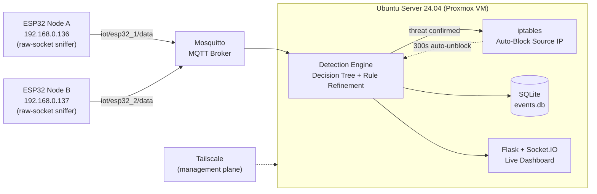

# Automated IoT Network Threat Detection & Mitigation System

**Real-time intrusion detection and automated firewall response for IoT networks, using a Decision Tree model on ESP32 edge sensors.**


> Final Year Project — Bachelor of Telecommunication Engineering Technology (BTET), Universiti Kuala Lumpur British Malaysian Institute (UniKL BMI).
> **Muhammad Syahmi Aiman bin Mohamad** · 51221124173

---

## Overview

IoT devices are too lightweight to run antivirus or a full firewall, which leaves them exposed to network attacks. This project builds a **self-contained security system** that:

1. **Watches** IoT network traffic in real time from ESP32 edge sensors,
2. **Classifies** each traffic window with a trained Decision Tree model (hardened by a rule-based refinement layer), and
3. **Mitigates** confirmed threats automatically by blocking the source IP at the firewall — **no human in the loop**.

The entire pipeline runs on affordable hardware (two ESP32 microcontrollers + one server) and reacts in **under 10 milliseconds**.

| Metric | Result |
|---|---|
| **Model accuracy** | **96.79%** (test set, 10,585 samples) |
| **Mitigation latency** | **8.8 ms** average detect → block |
| **Attack types** | 4 (Port Scan, DDoS, Brute Force, USB-malware) |
| **System-level validation** | 100% detection, **0 false positives / 0 false negatives** |
| **Live events processed** | 53,162 across 2 nodes, 22 automatic blocks |

---

## Network Architecture



**Three tiers:**

- **Sensing (edge):** 2× ESP32 in raw-socket/promiscuous mode monitor TCP traffic, extract 8 flow features, and publish every 3 s over MQTT. Separate topics per node (static IPs) so the dashboard attributes every event to the node that saw it.
- **Processing (server):** Mosquitto feeds a Python engine — the Decision Tree classifies each window, a rule layer corrects edge cases, and confirmed threats trigger an automatic `iptables` block. Events persist to SQLite; management runs on a **separate Tailscale plane** to avoid self-lockout when an attacker IP is blocked.
- **Presentation (dashboard):** real-time Flask + Socket.IO web UI showing live traffic, per-node status, ML decisions, severity, active blocks, and the confusion matrix.

---

## Methodology

### Machine learning
- **Model:** Decision Tree classifier (scikit-learn).
- **Features (8):** `duration_sec`, `total_bytes`, `total_pkts`, `bytes_per_sec`, `pkts_per_sec`, `avg_pkt_size`, `fwd_bwd_byte_ratio`, `fwd_bwd_pkt_ratio`.
- **Datasets:** Bot-IoT, UNSW-NB15 and CICIDS2017 (public) blended with custom ESP32-captured traffic.
- **Class balancing:** SMOTE applied **after** the train/test split (applying it before causes data leakage).
- **Evaluation:** prioritises precision / recall / F1 over raw accuracy because of class imbalance.

### Hybrid ML + rule-based refinement
A pure classifier confuses attacks that share a feature signature (e.g. Port Scan vs. DDoS) and occasionally mislabels heavy-but-normal traffic. A deterministic refinement layer fixes this **without retraining**:
- **Slow-scan guard:** a 60-second sliding window tracks *true* unique destination ports, catching stealth scans each 3 s window would miss.
- **DDoS vs. Port Scan disambiguation:** few ports + high packet rate → DDoS; many ports → Port Scan.
- **False-positive guards:** a model "DDoS" call at a low packet rate, or a "Port Scan" call touching very few ports, is corrected back to **Normal**.
- **Brute Force:** confirmed by repeated failed-login signatures.

### Attack coverage & a key design decision
- **Port Scan**, **DDoS** (DoS and DDoS deliberately unified — same flooding signature, same mitigation), **Brute Force**, **USB-malware**.
- **USB-malware is detected behaviorally** (its network propagation pattern) rather than with extra hardware — a documented design choice with ~&lt;5 false positives per 1000 events vs. ~990 for physical/voltage detection.

---

## Results

### Model performance (test set, 10,585 samples — overall accuracy **96.79%**)

| Class | Precision | Recall | F1-score | Support |
|---|---|---|---|---|
| Brute Force | 94.5% | 97.0% | 95.7% | 2,767 |
| DDoS | 98.9% | 98.8% | 98.8% | 2,818 |
| Normal | 95.7% | 93.6% | 94.6% | 3,000 |
| Port Scan | 98.8% | 98.4% | 98.6% | 2,000 |

### Confusion matrix (rows = actual, columns = predicted)

| | Brute Force | DDoS | Normal | Port Scan |
|---|---|---|---|---|
| **Brute Force** | **2683** | 0 | 84 | 0 |
| **DDoS** | 0 | **2785** | 20 | 13 |
| **Normal** | 156 | 24 | **2809** | 11 |
| **Port Scan** | 1 | 8 | 23 | **1968** |

### Feature importance

| Feature | Importance |
|---|---|
| `fwd_bwd_pkt_ratio` | 34.06% |
| `fwd_bwd_byte_ratio` | 25.46% |
| `avg_pkt_size` | 12.89% |
| `total_bytes` | 12.87% |
| `pkts_per_sec` | 9.77% |
| `duration_sec` | 2.41% |
| `total_pkts` | 1.44% |
| `bytes_per_sec` | 1.10% |

### Mitigation latency (detect → firewall block)

Measured from 12 real block events on the deployed system:

| Metric | Value |
|---|---|
| Average | **8.8 ms** |
| Median | 8.7 ms |
| Min | 8.4 ms |
| Max | 9.5 ms |

### Live deployment statistics (from `events.db`)

- **53,162** real traffic events processed across both nodes.
- **Node A:** 26,688 events / 68 threats · **Node B:** 26,474 events / 19 threats.
- **22** automatic `iptables` blocks executed; **39** events corrected by the rule layer.
- Average attack confidence **98.0%**; peak traffic **946 packets/sec**.

### Sample mitigation log

```
2026-11-04 23:34:27  DDoS [R]   Node B  src=192.168.0.32  conf=97.7%  946 pps  -> ACTION: BLOCKED (auto-unblock 300s)
2026-11-04 23:34:27  BLOCKED 192.168.0.32 | reason: DDoS | response_ms=8.6
2026-11-04 23:34:37  DDoS [R]   Node B  src=192.168.0.32  conf=97.7%  853 pps  -> ALREADY BLOCKED
2026-11-04 23:39:41  Port Scan  Node A  src=192.168.0.32  conf=99.1%  -> ACTION: BLOCKED (auto-unblock 300s)
2026-11-04 23:40:12  UNBLOCKED 192.168.0.32 | reason: timeout expired (300s)
```

### End-to-end system validation

Running the full pipeline (model **+** rules) against 12 labelled ground-truth payloads — including the boundary cases (slow scans, heavy-but-normal traffic):

```
Total test cases          : 12  (8 attack, 4 normal)
Correct (final==truth)    : 12/12 = 100.0%
Attack detection rate     : 8/8   = 100.0%
False POSITIVE            : 0/4   = 0.0%
False NEGATIVE            : 0/8   = 0.0%
```

---

## Key Technical Contributions

- **Packet-level beats application-level detection.** Application-level firmware showed *zero* response to an nmap SYN scan; the packet-level version showed a ~1000× traffic spike — a central finding.
- **Hybrid ML + rule refinement** resolves classifier ambiguity and false positives that pure ML could not, on resource-constrained hardware, without retraining.
- **Behavioral USB-malware detection** via network patterns — no extra hardware, scalable.
- **Management/data-plane separation** (Tailscale vs. LAN) keeps the operator reachable even while the system blocks attacker IPs on the same network.

---

## Tech Stack

`Python` · `scikit-learn` · `Embedded C (ESP32 / Arduino)` · `MQTT (Mosquitto)` · `Linux (Ubuntu Server)` · `iptables` · `Flask + Socket.IO` · `SQLite` · `Proxmox VE` · `Tailscale` · `nmap` · `hping3` · `hydra` · `SMOTE`

---

## Repository Structure

```
.
├── esp32_firmware/
│   ├── fyp_firmware_nodeA/      # Node A firmware (static IP, 60s slow-scan tracking)
│   └── fyp_firmware_nodeB/      # Node B firmware
├── server/
│   ├── dashboard/
│   │   ├── app.py               # Detection engine + MQTT + iptables + dashboard
│   │   ├── templates/           # Dashboard UI (Flask + Socket.IO)
│   │   └── test_report.py       # Automated detection-rate / FP / FN report
│   ├── train_model.py           # Train the Decision Tree (SMOTE after split)
│   ├── make_confusion.py        # Confusion matrix from the held-out test set
│   ├── chapter4_data.py         # Generate all results tables + CSVs
│   ├── combine_datasets.py      # Dataset preparation
│   └── models_output/           # Trained model.pkl + scaler.pkl
├── iotsoc_demo.sh               # Interactive attack launcher (lab use)
├── attack_batch.sh              # Automated attack batch for data collection
└── start_server.sh              # One-command server startup
```

---

## Quick Start (server)

```bash
# 1. Start the broker and detection engine
cd ~/fyp/dashboard
source ~/fyp/venv/bin/activate
python3 app.py                       # dashboard at http://<server>:5000

# 2. (optional) Re-train the model
python3 ../train_model.py
python3 ../make_confusion.py

# 3. Generate the results pack
python3 ../chapter4_data.py          # tables + CSVs in chapter4_output/
python3 test_report.py               # detection rate / FP / FN report
```

ESP32 firmware is flashed from the Arduino IDE (Wi-Fi SSID and MQTT broker IP are set at the top of each `.ino`).

---

## Scope, Limitations & Future Work

- Validated as a **working proof-of-concept prototype** in a controlled lab (own LAN and ESP32 nodes); the same detection logic is designed to scale to larger deployments.
- Forward/backward ratio features are currently approximated (1.0); full bidirectional flow tracking is a documented future-work item.
- Coverage is four attack classes; the framework extends by retraining on additional labelled data.

---

## Author

**Muhammad Syahmi Aiman bin Mohamad** — Bachelor of Telecommunication Engineering Technology (BTET), UniKL BMI.
Focus: cybersecurity, network security, and network engineering.

> All figures in this README are measured from the deployed system (events database and model test set), not simulated.
