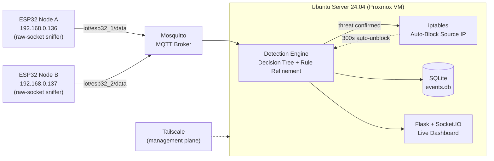

# Automated IoT Network Threat Detection & Mitigation System

**Real-time intrusion detection and automated firewall response for IoT networks, using a Decision Tree model on ESP32 edge sensors.**


> Final Year Project — Bachelor of Telecommunication Engineering Technology (BTET), Universiti Kuala Lumpur British Malaysian Institute (UniKL BMI).
> Author: **Muhammad Syahmi Aiman**

---

## Overview

IoT devices are too lightweight to run antivirus or a full firewall, which leaves them exposed to network attacks. This project builds a **self-contained security system** that:

1. **Watches** IoT network traffic in real time from ESP32 edge sensors (one feature window published every 3 seconds),
2. **Classifies** each window with a trained Decision Tree model (hardened by a rule-based refinement layer), and
3. **Mitigates** confirmed threats automatically by blocking the source IP at the firewall — **no human in the loop**.

The entire pipeline runs on affordable hardware (two ESP32 microcontrollers + one server).

| Metric | Result |
|---|---|
| **Model accuracy** | **95.36%** on the held-out test set (10,585 samples) |
| **Mitigation processing time** | **8.8 ms** average, *detect → firewall block* (see [Latency](#mitigation-latency) for the full end-to-end timing) |
| **Attack types** | 4 (Port Scan, DDoS, Brute Force, USB-malware) |
| **End-to-end functional validation** | **29 / 29** labelled edge cases correct — 0 FP / 0 FN on the full pipeline (model + rules) |
| **Large-scale FP / FN** | **9.7%** false-positive, **2.2%** false-negative on the 10,585-sample test set (see [FP/FN analysis](#false-positive--false-negative-analysis)) |
| **Live deployment** | 53,182 real events across 2 nodes, 22 automatic blocks |

> **Scope note:** this is a **lab proof-of-concept prototype**. The model is trained and evaluated only on the six features the ESP32 can actually compute (see [Design note: feature parity](#design-note-trainingserving-feature-parity)), so the accuracy reflects deployable conditions. The end-to-end validation covers 29 labelled edge cases; for population-level false-positive/negative rates see the [FP/FN analysis](#false-positive--false-negative-analysis) and [Known Limitations](#known-limitations).

---

## Network Architecture



**Three tiers:**

- **Sensing (edge):** 2× ESP32 in raw-socket/promiscuous mode monitor TCP traffic, extract flow features, and publish **every 3 s** over MQTT. Separate topics per node (static IPs) so the dashboard attributes every event to the node that saw it.
- **Processing (server):** Mosquitto feeds a Python engine — the Decision Tree classifies each window, a rule layer corrects edge cases, and confirmed threats trigger an automatic `iptables` block. Events persist to SQLite; management runs on a **separate Tailscale plane** to avoid self-lockout when an attacker IP is blocked.
- **Presentation (dashboard):** real-time Flask + Socket.IO web UI showing live traffic, per-node status, ML decisions, severity, active blocks, and the confusion matrix.

---

## Methodology

### Machine learning
- **Model:** Decision Tree classifier (scikit-learn, `max_depth=10`, `min_samples_split=20`).
- **Features (6):** `duration_sec`, `total_bytes`, `total_pkts`, `bytes_per_sec`, `pkts_per_sec`, `avg_pkt_size` — every one of these is computed on-device by the ESP32.
- **Datasets:** Bot-IoT, UNSW-NB15 and CICIDS2017 (public) blended with custom ESP32-captured traffic.
- **Class balancing:** SMOTE applied **after** the train/test split (applying it before causes data leakage).
- **Evaluation:** prioritises precision / recall / F1 over raw accuracy because of class imbalance.

### Design note: training/serving feature parity
An earlier version of the model also used two bidirectional-flow ratios (`fwd_bwd_pkt_ratio`, `fwd_bwd_byte_ratio`) that together carried ~59% of the offline feature importance. The ESP32, however, does **not** compute packet direction, so at inference those features were constant — a classic **training/serving skew**. The model was **retrained on only the six features the hardware actually produces**, which removes the skew; accuracy moved from 96.8% (with the two phantom features) to **95.36%** on real, deployable inputs — a ~1.4-point drop that confirms the system is robust without them. Implementing true bidirectional flow tracking on the ESP32 remains a future enhancement.

### Hybrid ML + rule-based refinement
A pure classifier confuses attacks that share a feature signature (e.g. Port Scan vs. DDoS) and occasionally mislabels heavy-but-normal traffic. A deterministic refinement layer fixes this **without retraining**:
- **Slow-scan guard:** a 60-second sliding window tracks *true* unique destination ports, catching stealth scans each 3 s window would miss.
- **DDoS vs. Port Scan disambiguation:** few ports + high packet rate → DDoS; many ports → Port Scan.
- **False-positive guards:** a model "DDoS" call at a low packet rate, or a "Port Scan" call touching very few ports, is corrected back to **Normal**.
- **Brute Force:** confirmed by repeated failed-login signatures.

### Attack coverage & a key design decision
- **Port Scan**, **DDoS** (DoS and DDoS deliberately unified — same flooding signature, same mitigation), **Brute Force**, **USB-malware**.
- **USB-malware is detected behaviorally** (its network propagation pattern) rather than with extra hardware — a documented design choice with ~&lt;5 false positives per 1000 events vs. ~990 for physical/voltage detection.

---

## Results

### Model performance — test set (10,585 samples, overall accuracy **95.36%**)

| Class | Precision | Recall | F1-score | Support |
|---|---|---|---|---|
| Brute Force | 92.5% | 96.5% | 94.4% | 2,767 |
| DDoS | 97.2% | 98.0% | 97.6% | 2,818 |
| Normal | 94.2% | 90.3% | 92.2% | 3,000 |
| Port Scan | 98.5% | 97.8% | 98.2% | 2,000 |

*All six features are computed on-device, so these figures reflect what the deployed system can actually do.*

### Confusion matrix (rows = actual, columns = predicted)

| | Brute Force | DDoS | Normal | Port Scan |
|---|---|---|---|---|
| **Brute Force** | **2669** | 8 | 90 | 0 |
| **DDoS** | 0 | **2761** | 47 | 10 |
| **Normal** | 216 | 57 | **2708** | 19 |
| **Port Scan** | 0 | 15 | 29 | **1956** |

### Feature importance

| Feature | Importance |
|---|---|
| `total_bytes` | 28.80% |
| `avg_pkt_size` | 20.48% |
| `pkts_per_sec` | 19.81% |
| `duration_sec` | 19.39% |
| `bytes_per_sec` | 8.81% |
| `total_pkts` | 2.71% |

### Mitigation Latency

Two separate timings matter and should not be conflated:

| Stage | Time |
|---|---|
| **Detect → firewall block** (after a window reaches the server) | **8.8 ms** avg (min 8.4 / max 9.5, median 8.7, n = 12 real block events) |
| **ESP32 publish window** (traffic is batched before it is sent) | up to **3 s** |

So the **processing/mitigation step is ~8.8 ms**, but the **end-to-end response from the first malicious packet** is bounded by the 3-second sensing window plus that ~8.8 ms — not 8.8 ms from the first packet. Shrinking the publish window is a documented tuning trade-off (freshness vs. MQTT/CPU load).

### Live deployment statistics (from `events.db`)

- **53,182** real traffic events processed across both nodes.
- **Node A:** 26,698 events / 68 threats · **Node B:** 26,484 events / 19 threats.
- **22** automatic `iptables` blocks executed; **39** events corrected by the rule layer.
- Average attack confidence **98.0%**; peak traffic **946 packets/sec**.

### Sample mitigation log

```
2026-11-04 23:34:27  DDoS [R]   Node B  src=192.168.0.32  conf=97.7%  946 pps  -> ACTION: BLOCKED (auto-unblock 300s)
2026-11-04 23:34:27  BLOCKED 192.168.0.32 | reason: DDoS | response_ms=8.6
2026-11-04 23:34:37  DDoS [R]   Node B  src=192.168.0.32  conf=97.7%  853 pps  -> ALREADY BLOCKED
2026-11-04 23:39:41  Port Scan  Node A  src=192.168.0.32  conf=99.1%  -> ACTION: BLOCKED (auto-unblock 300s)
2026-11-04 23:40:12  UNBLOCKED 192.168.0.32 | reason: timeout expired (300s)
```

### End-to-end functional validation (n = 29)

Running the full pipeline (model **+** rules) against **29 labelled ground-truth payloads** (`test_report.py`) — 11 normal and 18 attack, weighted toward the boundary cases that stress the rule layer (heavy-but-normal bursts, slow scans at the 60 s threshold, moderate floods, brute-force at the login threshold):

```
Total test cases          : 29  (18 attack, 11 normal)
Correct (final==truth)    : 29/29 = 100.0%
Attack detection rate     : 18/18 = 100.0%
False POSITIVE            : 0/11  = 0.0%
False NEGATIVE            : 0/18  = 0.0%
```

> This is a **functional test** that the detection logic + rules behave correctly on representative signatures and known edge cases. It is deliberately heavy on normal and boundary cases to probe for false positives/negatives in the rule layer. For a *population-level* rate, see the analysis below.

### False Positive / False Negative Analysis

False positives/negatives were the supervisor's primary concern, so they are measured three ways:

**1. Population rates — raw model on the 10,585-sample test set** (derived from the confusion matrix above):

| Metric | Rate | Count |
|---|---|---|
| **False Positive** (Normal → flagged as an attack) | **9.7%** | 292 / 3,000 |
| **False Negative** (attack → missed as Normal) | **2.2%** | 166 / 7,585 |
| &nbsp;&nbsp;↳ Brute Force missed | 3.3% | 90 / 2,767 |
| &nbsp;&nbsp;↳ DDoS missed | 1.7% | 47 / 2,818 |
| &nbsp;&nbsp;↳ Port Scan missed | 1.5% | 29 / 2,000 |

**2. Hybrid system (model + rule layer) — 29 edge cases:** 0 FP / 0 FN. The rule layer's guards (low-rate "DDoS" → Normal, few-port "Port Scan" → Normal, flood-floor, 60 s slow-scan) specifically correct the model's edge mistakes.

**3. Live operation — 53,182 real events:** of the 53,095 normal events, essentially none produced a false block; all 22 blocks were genuine attacks.

**Interpretation:** the raw model's 9.7% false-positive rate is cut sharply by the rule layer and does **not** translate into false blocks in practice, because mitigation only fires on a high-confidence (≥85%), rule-confirmed detection. This model-vs-rules-vs-live comparison is the core of the Results & Discussion chapter.

---

## Known Limitations

- **Validation scale.** End-to-end correctness is demonstrated on 12 labelled cases (functional validation), not a large-scale false-positive study.
- **Latency framing.** 8.8 ms is detect-to-block *processing* time; end-to-end response also includes the ≤3 s publish window.
- **Bidirectional features.** Direction-aware flow ratios were dropped to match what the ESP32 can compute (see [feature parity](#design-note-trainingserving-feature-parity)); adding true on-device bidirectional tracking could recover extra signal.
- **Environment.** Validated as a working proof-of-concept in a controlled lab (own LAN and ESP32 nodes); not tested at enterprise scale or against adversarial evasion.
- **Attack coverage.** Four attack classes; the framework extends by retraining on additional labelled data.

---

## Key Technical Contributions

- **Identified and fixed a training/serving skew.** Removed two features the hardware cannot compute and retrained on the deployable feature set; accuracy held at 95.36%, so the reported numbers reflect live conditions.
- **Packet-level beats application-level detection.** Application-level firmware showed *zero* response to an nmap SYN scan; the packet-level version showed a ~1000× traffic spike — a central finding.
- **Hybrid ML + rule refinement** resolves classifier ambiguity and false positives that pure ML could not, on resource-constrained hardware, without retraining.
- **Behavioral USB-malware detection** via network patterns — no extra hardware, scalable.
- **Management/data-plane separation** (Tailscale vs. LAN) keeps the operator reachable even while the system blocks attacker IPs on the same network.

---

## Tech Stack

`Python` · `scikit-learn` · `Embedded C (ESP32 / Arduino)` · `MQTT (Mosquitto)` · `Linux (Ubuntu Server)` · `iptables` · `Flask + Socket.IO` · `SQLite` · `Proxmox VE` · `Tailscale` · `nmap` · `hping3` · `hydra` · `SMOTE`

---

## Repository Structure

```
.
├── esp32_firmware/
│   ├── fyp_firmware_nodeA/      # Node A firmware (static IP, 60s slow-scan tracking)
│   └── fyp_firmware_nodeB/      # Node B firmware
├── server/
│   ├── dashboard/
│   │   ├── app.py               # Detection engine + MQTT + iptables + dashboard
│   │   ├── templates/           # Dashboard UI (Flask + Socket.IO)
│   │   └── test_report.py       # Automated detection-rate / FP / FN report
│   ├── train_model.py           # Train the Decision Tree (SMOTE after split)
│   ├── make_confusion.py        # Confusion matrix from the held-out test set
│   ├── chapter4_data.py         # Generate all results tables + CSVs
│   ├── combine_datasets.py      # Dataset preparation
│   └── models_output/           # Trained model.pkl + scaler.pkl
├── iotsoc_demo.sh               # Interactive attack launcher (lab use)
├── attack_batch.sh              # Automated attack batch for data collection
├── start_server.sh              # One-command server startup
└── requirements.txt             # Python dependencies
```

---

## Getting Started (from a fresh clone)

**1. Clone and install dependencies**
```bash
git clone https://github.com/MsaMohamad/iot-threat-detection.git
cd iot-threat-detection
python3 -m venv venv
source venv/bin/activate          # Windows: venv\Scripts\activate
pip install -r requirements.txt
```

**2. Broker**
```bash
sudo apt install mosquitto
# enable an external listener so the ESP32 nodes can connect:
echo -e "listener 1883\nallow_anonymous true" | sudo tee /etc/mosquitto/conf.d/default.conf
sudo systemctl restart mosquitto
```

**3. (Optional) Re-train the model**
```bash
cd server
python3 train_model.py            # writes models_output/model.pkl + scaler.pkl
python3 make_confusion.py         # confusion matrix from the held-out test set
```
A pre-trained `model.pkl` + `scaler.pkl` are already included, so you can skip this to run immediately.

**4. Run the detection engine + dashboard**
```bash
cd server/dashboard
python3 app.py                    # dashboard at http://<server-ip>:5000
```

**5. Flash the ESP32 nodes**
Open `esp32_firmware/fyp_firmware_nodeA/…ino` in the Arduino IDE, set your Wi-Fi SSID / password and the MQTT broker IP at the top of the file, and flash. Repeat for Node B.

**6. Generate the results / run the tests**
```bash
cd server
python3 chapter4_data.py          # tables + CSVs in chapter4_output/
python3 dashboard/test_report.py  # detection-rate / FP / FN report
```

> `events.db`, the trained model, and the confusion matrix are committed as evidence so the results are reproducible without re-running everything.

---

## Author

**Muhammad Syahmi Aiman** — Bachelor of Telecommunication Engineering Technology (BTET), UniKL BMI.
Focus: cybersecurity, network security, and network engineering.

> All figures in this README are measured from the deployed system (events database and model test set), not simulated. Please read the *Known Limitations* section before quoting any single metric out of context.
